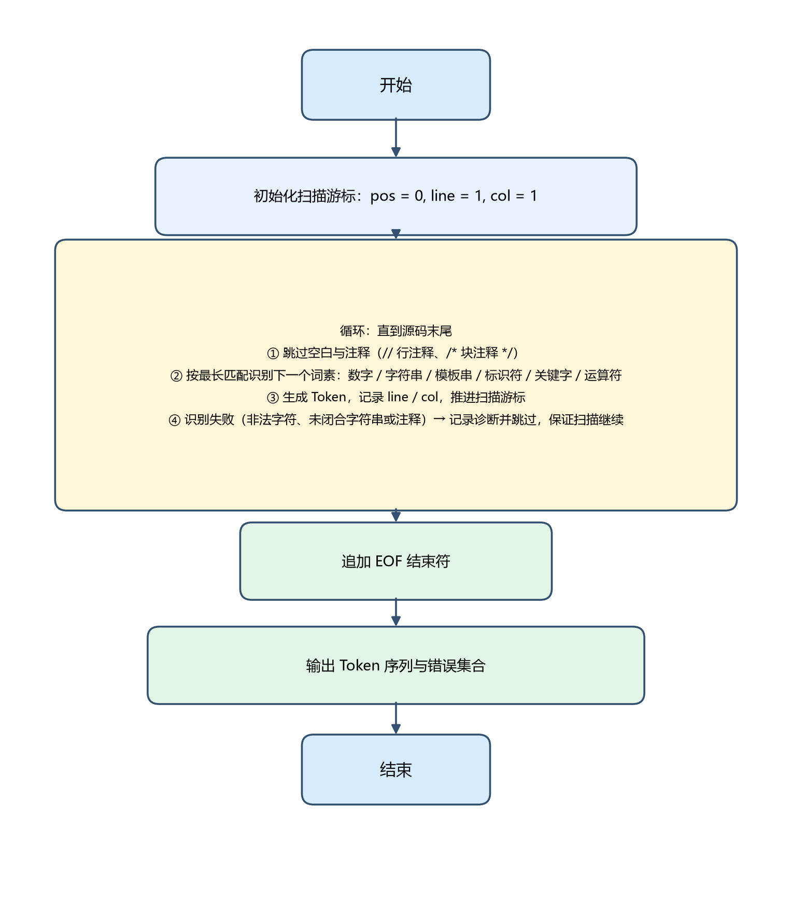
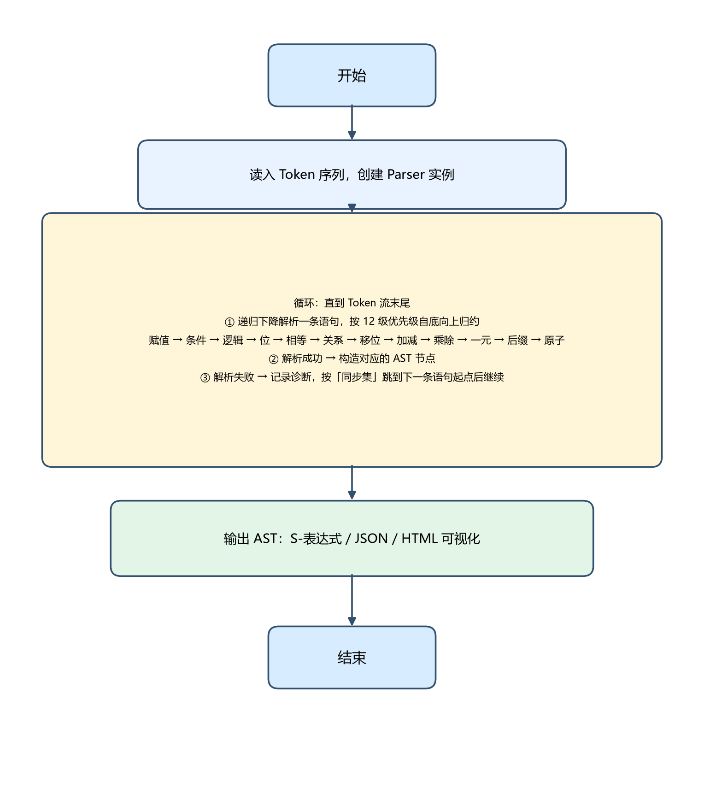
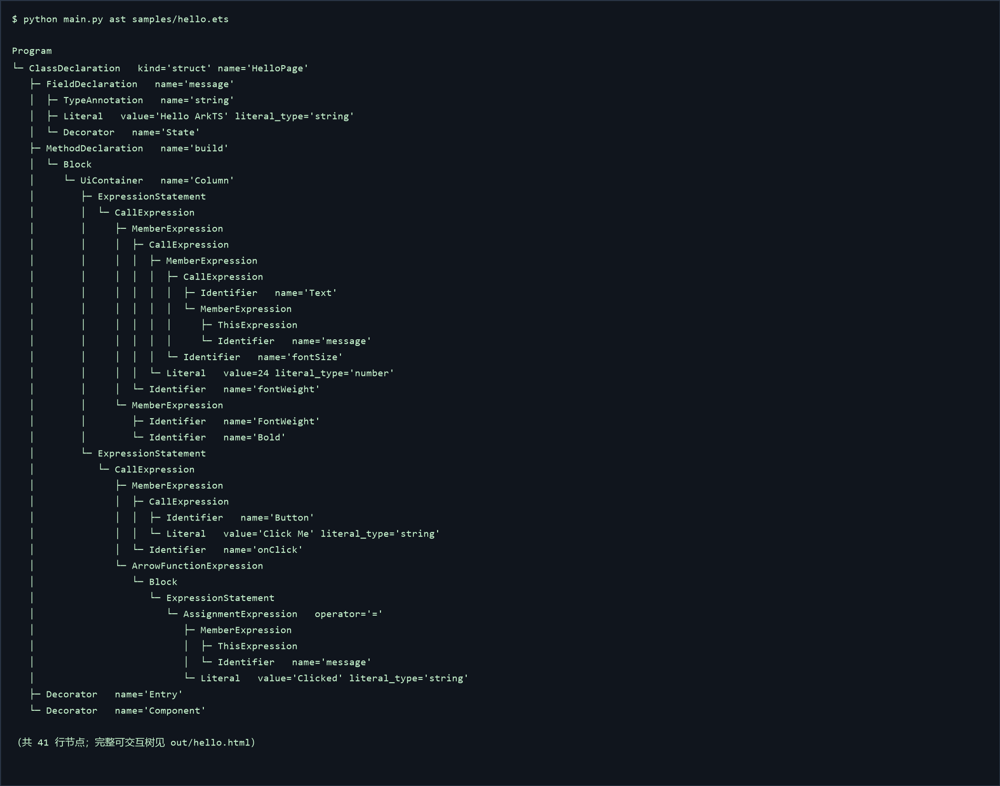
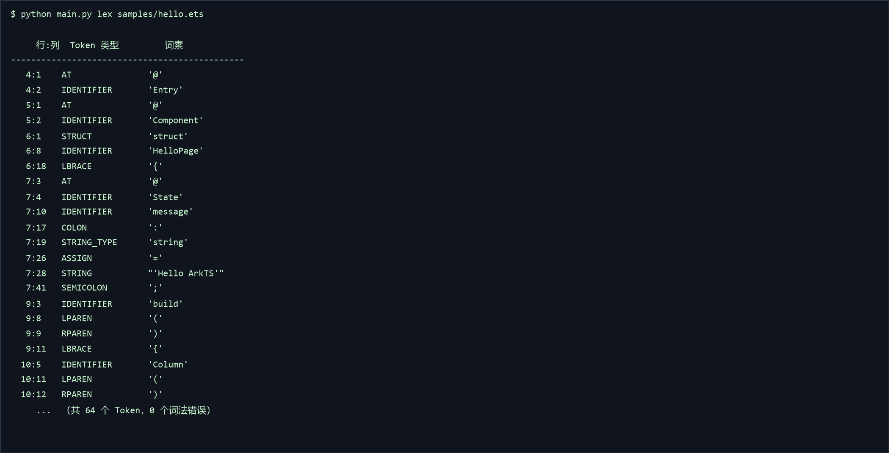

# 实验一  鸿蒙 ArkTS 词法分析与语法分析器设计

## 1 内容简介

本实验完成了一个面向鸿蒙应用开发语言 ArkTS 的编译器前端，覆盖词法分析与语法分析两个阶段。词法阶段定义了 ArkTS 子集的词法规则并实现词法分析器，把源代码字符串切分为 Token 序列；语法阶段为 ArkTS 核心子集定义了上下文无关文法，并采用递归下降法实现语法分析器，把 Token 序列构造为抽象语法树（AST）。在此基础上实现了 AST 的遍历、S-表达式打印、JSON 序列化导出以及浏览器中的树形可视化，并针对非法字符、未闭合字符串、缺少分号、括号不匹配等错误实现了检测、定位与恢复。

与标准 TypeScript 相比，本实验重点处理了 ArkTS 的私有语法结构：

- 装饰器：@Entry、@Component、@State、@Prop、@Builder 等；
- 组件声明：struct 组件与 class、interface 并存；
- 声明式 UI：build() 方法中形如 Column() { Text('hi') } 的「组件调用 + 尾随块」结构。

实现采用 Python 3 编写，共 8 个源码模块（约 1200 行），配套 30 个单元测试；另提供命令行入口 main.py 与一键验证脚本 build.py。实测 3 个合法样例（hello.ets、counter.ets、algorithms.ets）解析零错误，1 个错误样例可一次性报出 6 条诊断，30 个单元测试全部通过。

## 2 实验上机试题

（1）词法分析：

- 定义 ArkTS 语言的词法规则，包括关键字（let、const、if、for、class、struct 等）、标识符、数字字面量、字符串字面量、注释、运算符及分隔符；
- 实现词法分析器，输入为 ArkTS 源代码字符串，输出为对应的 Token 序列；
- 处理词法错误，如非法字符、未闭合的字符串等。

（2）语法分析：

- 选取 ArkTS 的一个核心子集（变量声明、赋值语句、if-else 语句、while/for 循环、函数定义与调用、类与结构体及装饰器、声明式 UI），定义其上下文无关文法；
- 基于所选文法实现递归下降分析器；
- 将输入的 Token 序列解析为抽象语法树（AST），并实现 AST 的遍历与打印功能；
- 处理语法错误，如括号不匹配、缺少分号等。

## 3 算法实现

### 3.1 算法流程设计

*图1.1  词法分析器算法流程图*

词法分析器采用单遍扫描（one-pass）。进入循环后先跳过空白与注释，再依据当前字符的类别分派到对应的读取子过程：数字按进制前缀 / 小数 / 指数形式识别；字符串与模板串处理转义序列并判定是否闭合；标识符读取完成后查关键字表决定其是关键字还是普通标识符；运算符则把运算符表按长度降序排列后逐项做前缀匹配，以保证最长匹配（例如 === 优先于 ==，>>> 优先于 >>）。每识别出一个词素即生成 Token 并记录行列号；识别失败时并不终止，而是记录一条诊断后跳过该字符，从而保证一次扫描能够报告多个错误。

*图1.2  语法分析器算法流程图*

语法分析器采用递归下降法，为文法的每个非终结符编写一个解析函数，并按运算符优先级分层：赋值 → 条件 → 逻辑 → 位运算 → 相等 → 关系 → 移位 → 加减 → 乘除 → 一元 → 后缀 → 原子，逐层下降，从而无需回溯即可确定唯一分析路径。解析一条语句成功时构造对应的 AST 节点；失败时抛出携带位置信息的诊断，由语句层的「恐慌模式」捕获，随后按同步集跳过若干 Token，恢复到下一条语句的起点继续解析，因此一次编译能够报告多个语法错误。

### 3.2 实现结果

*图1.3  samples/hello.ets 解析得到的抽象语法树（缩进打印）*

图 1.3 为 samples/hello.ets 的 AST 打印结果。可以看到：@Entry、@Component 装饰器被解析为 Decorator 节点并挂载到ClassDeclaration(kind=struct) 上；@State 修饰的字段成为带装饰器的 FieldDeclaration；build() 方法被解析为 MethodDeclaration，其方法体中的 Column() { ... } 被识别为 UiContainer，子组件 Text、Button 则作为其 children，Text 后面的 .fontSize(24) 等链式调用被解析为 MemberExpression 与 CallExpression 的组合。

*图1.4  samples/hello.ets 的词法分析输出（前若干 Token）*

图 1.4 为同一份源码的词法分析输出，共 64 个 Token、0 个词法错误，可见 @、标识符、关键字、字符串、运算符等词素均被正确切分并标注了行列位置。

除终端打印外，程序还支持把 AST 导出为 JSON 并生成单文件 HTML 可视化页面（不依赖任何外部库，可离线使用），在浏览器中可折叠与搜索节点。完整产物见 out/hello.html、out/counter.html、out/algorithms.html。

## 4 测试

针对词法与语法两个试题分别设计测试用例，覆盖正常值、边界值与错误值。

**表1.1  试题1（词法分析）测试用例**

| 用例编号 | 测试项 | 测试步骤 | 预期结果 | 测试结果 |
| --- | --- | --- | --- | --- |
| 1 | 输入合法值 | 输入 let count = 0; ，调用词法分析器 | 依次得到 LET、IDENTIFIER、ASSIGN、NUMBER、SEMICOLON、EOF 共 6 个 Token，无错误 | 通过 |
| 2 | 边界值：空输入 | 输入空字符串 | 仅产生 1 个 EOF Token，错误数为 0 | 通过 |
| 3 | 边界值：多形式数字字面量 | 输入 0 42 3.14 1e3 0xFF 0b1010 1_000 | 识别出 7 个 NUMBER，词素原文与输入完全一致 | 通过 |
| 4 | 边界值：多字符运算符最长匹配 | 输入 === !== >>> => ?. | 依次识别为 STRICT_EQ、STRICT_NEQ、USHR、ARROW、OPTIONAL_CHAIN，未出现拆分错误 | 通过 |
| 5 | 等价类：注释 | 分别输入 let x=1; // 行注释 与 /* 块注释 */ const y=2; | 注释被完整跳过，不产生 Token 且不报错 | 通过 |
| 6 | 边界值：行列定位 | 输入两行代码 let x; 换行 两个空格 + let y; | 第二个标识符 y 的位置记录为 第 2 行第 7 列 | 通过 |
| 7 | 输入错误值：未闭合字符串 | 输入 let s = 'abc | 报错「未闭合的字符串字面量」，位置 1:9，且扫描继续不崩溃 | 通过 |
| 8 | 输入错误值：非法字符 | 输入 let a = #; let b = 2; | 报错「非法字符 '#'」，且仍能识别出后续 2 个 let 关键字 | 通过 |

**表1.2  试题2（语法分析）测试用例**

| 用例编号 | 测试项 | 测试步骤 | 预期结果 | 测试结果 |
| --- | --- | --- | --- | --- |
| 1 | 输入合法值：变量声明 | 输入 let x: number = 1; | 生成 VariableDeclaration，含 TypeAnnotation(number) 与 Literal(1) | 通过 |
| 2 | 输入合法值：鸿蒙组件 | 输入 @Entry @Component struct Page { @State n: number = 0; build() { Text('hi') } } | 生成 ClassDeclaration(kind=struct)，含 2 个 Decorator、FieldDeclaration、MethodDeclaration，build() 中 Text('hi') 被识别为 UiContainer 的子语句 | 通过 |
| 3 | 边界值：if 无 else 分支 | 输入 if (a) { b = 1; } | 生成 IfStatement，且 alternate 字段为空 | 通过 |
| 4 | 边界值：运算符优先级 | 输入 let r = 1 + 2 * 3; | 乘法节点嵌套在加法节点之内（先算 * 再算 +） | 通过 |
| 5 | 等价类：箭头函数两种写法 | 分别输入 (a: number) => a + 1 与 x => x * 2 | 均生成 ArrowFunctionExpression，表达式体与块体均正确 | 通过 |
| 6 | 输入错误值：缺少分号 | 输入 let x = 1 换行 let y = 2; | 报错「缺少分号 ';'」，且错误恢复后仍解析出第二条变量声明 | 通过 |
| 7 | 输入错误值：括号不匹配 | 输入 if (a) { b = 1;（缺少右花括号） | 报错「期望 '}'，但遇到 文件结尾」 | 通过 |
| 8 | 输入错误值：缺少表达式 | 输入 let x = ; | 报语法错误并定位到分号所在位置 | 通过 |

说明：以上用例均已在 tests/test_lexer.py 与 tests/test_parser.py 中实现为自动化单元测试，执行 python -m unittest discover -s tests 可一次性运行全部 30 个用例，实测结果全部通过。错误用例不仅校验「报错」，还校验「报错后能继续解析后续代码」，即错误恢复能力。

## 5 难点和解决办法

#### 难点 1：ArkTS 相对 TypeScript 的私有语法（装饰器 / struct / 声明式 UI）

问题：Column() { Text('hi') } 这种「函数调用 + 尾随代码块」并不是标准表达式语句，按普通调用文法解析会在遇到 { 时报「意外的 '{'」。

解决办法：在表达式语句的解析中加入前瞻——当解析完一个 CallExpression 后紧随 { 时，就把它升级为专门的 UiContainer 节点，把尾随块解析为 children 语句列表。这样声明式 UI 的嵌套结构（Column 套 Row、Row 套 Text）可以被递归、准确地表达。

#### 难点 2：错误恢复不能吞掉后续合法语句

问题：最初采用「跳到下一个分号」的同步策略，结果在 let x = 1（缺分号）之后，会把下一条合法语句 let y = 2; 整条吃掉，导致漏报。

解决办法：把同步集细分为三类——语句起始符（let/const/if/while/for/struct/@/…）：立即停止且不消费，交回上层继续解析；终止符（分号、右花括号）：消费后停止；其它 Token：跳过。同时保证每条恢复路径都至少前进一个 Token，避免死循环。

#### 难点 3：声明式 UI 组件不写分号 与「缺少分号」检测的冲突

问题：在 build() 中组件语句按 ArkTS 习惯不写分号，但其它位置缺分号必须报错，两者用同一套规则会互相干扰。

解决办法：引入 ui_depth 上下文标志，仅在 build() 与 @Builder 方法体内才容忍组件调用语句省略分号；其它位置缺少分号仍照常报错，从而既贴合鸿蒙代码风格，又保留了「缺少分号」的错误检测能力。

#### 难点 4：运算符的最长匹配

问题：若按固定顺序匹配运算符，=== 会被拆成 == 与 =，>>> 会被拆成 >> 与 >，导致 Token 序列错误。

解决办法：将所有运算符按长度降序排序后逐项做前缀匹配，命中即消费对应长度的字符。该策略同时自然地覆盖了 =>、?.、...、++ 等多字符运算符。

#### 算法具体应用场景

- 集成开发环境：语法高亮、代码补全、跳转与重构均直接依赖词法与语法分析结果；
- 静态检查工具：ARKTS 的强类型静态检查需要先得到正确的 AST，本实验的 AST 是实验二语义分析的基础；
- 方舟编译器前端：其编译流程为「词法 → 语法 → 语义 → IR → 机器码」，本实验完成的正是前两个阶段；
- 后续实验衔接：实验二在本实验的 AST 上做符号表与类型检查，实验三在此基础上生成中间表示（IR）。
