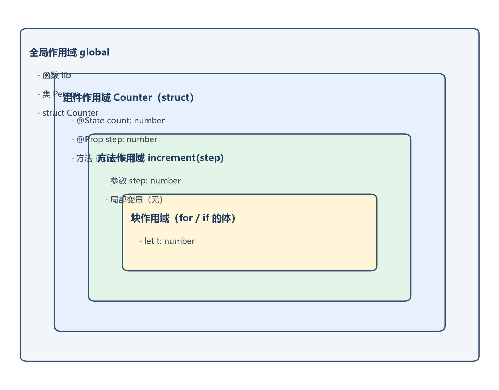
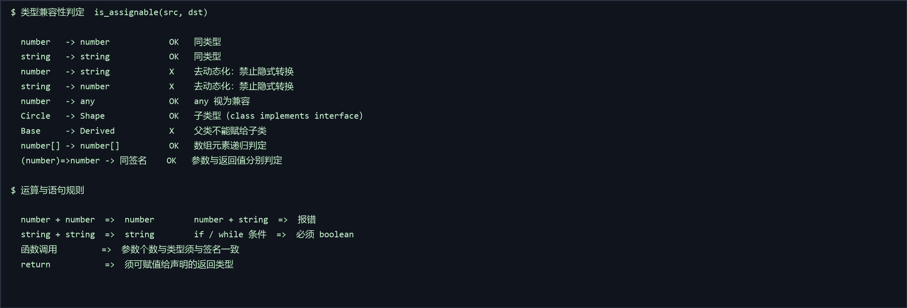
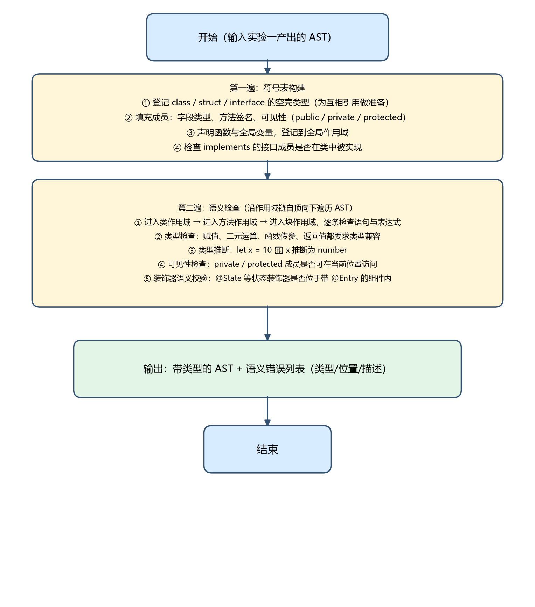
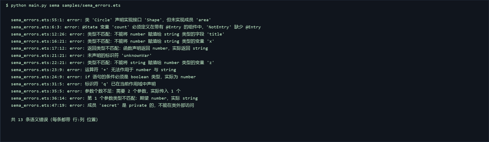

# 实验二  基于方舟编译器思想的语义分析与类型系统

## 1 内容简介

本实验在实验一生成的抽象语法树（AST）之上，实现了一个基于方舟编译器思想的语义分析器。方舟编译器与 JavaScript 动态类型体系的根本分野在于「去动态化」：类型必须在编译期确定，运行期不再有「类型可能随时改变」的开销，也正因为类型确定，后端才敢做静态布局、内联与去虚化等优化。本实验围绕这一理念实现三件事：① 构建支持多级作用域的符号表；② 实现严格静态类型系统，明确禁止 number 与 string 之间的隐式转换；③ 完成一整套语义检查，包括变量声明、类型匹配、函数调用、成员可见性、接口实现与装饰器语义约束。

- 符号表管理：设计支持作用域嵌套的符号表，形成「全局 → 组件/类 → 方法 → 块」多级作用域，登记变量、常量、参数、函数、类、结构体、接口、字段与方法，支持定义、查找与冲突检测；
- 类型系统实现：定义 ArkTS 基本类型的内部表示，实现类型等价判断、类型兼容检查（赋值兼容、函数参数兼容）与简单类型推断（let x = 10 推断为 number）；
- 语义检查：变量使用前是否声明、赋值与运算的类型是否匹配、函数调用的参数个数与类型、类成员访问的可见性（public/private）、接口实现是否完整，并收集报告语义错误（类型、位置、描述）；
- 装饰器语义校验：检查 @State 等状态装饰器是否定义在带 @Entry 的组件中，模拟鸿蒙运行时的约束。

实现采用 Python 3，新增 3 个模块（types.py 类型系统、symbols.py 符号表、sema.py 语义分析器，约 900 行），并为语法分析器补上了「接口方法签名（无方法体）」的支持。实测：正确样例零错误；错误样例一次性报出 13 条语义错误且每条都带精确行列；配套 34 个单元测试全部通过。

## 2 实验上机试题

（1）符号表管理：设计并实现符号表数据结构，支持作用域嵌套（全局、函数、块、类作用域）；实现对变量、函数、类、接口等符号的定义、查找与冲突检测。

（2）类型系统实现：定义 ArkTS 基本类型的内部表示；实现类型等价性判断、类型兼容性检查（赋值兼容性、函数参数兼容性）；实现简单的类型推断。

（3）语义检查：检查变量使用前是否声明；类型是否匹配（赋值、运算、传参）；函数调用的参数数量和类型；类成员访问的合法性；接口的实现检查；收集并报告语义错误信息。

## 3 算法实现

### 3.1 符号表的结构与作用域管理策略

符号表采用「符号—作用域—作用域栈」三层结构：Symbol 描述一个具名实体（种类、类型、装饰器、可见性修饰符、声明位置）；Scope 表示一个作用域，持有一张 name → Symbol 的符号表，并持有指向父作用域的指针；SymbolTable 维护一个作用域栈，current 指向当前最内层作用域。

- 作用域种类：global（全局）、class（组件/类/接口）、function（函数与方法）、block（for / if 的体）；
- 定义策略：define() 只写入当前作用域；若同名已存在则返回旧符号，由调用方报「重复定义」；
- 查找策略：resolve() 自内向外沿 parent 链回溯，因此内层符号可遮蔽外层同名符号，且天然实现「使用前声明」检查；
- 压栈/弹栈：进入方法体、块、for 头部时 push，离开时 pop，保证作用域与语法结构严格对应。



*图2.2  符号表的多级作用域结构*

组件作用域中同时存放状态字段（@State / @Prop）与方法，形成大纲要求的「组件-状态-方法」三级结构；由于 class 作用域独立于函数作用域，方法体内的变量不会污染组件作用域，同时又可以通过作用域链看到 this 与成员信息。

### 3.2 类型系统的核心设计

类型统一用 Type 数据类表示，用 TypeKind 区分种类：基本类型（NUMBER / STRING / BOOLEAN / VOID / NULL / UNDEFINED / ANY / NEVER）、复合类型（ARRAY / FUNCTION / UNION）与用户类型（CLASS / INTERFACE）。数组通过 element 字段表达元素类型，函数通过 param_types 与 return_type 表达签名，类与接口通过 members 保存成员（含类型与可见性）、通过 bases 保存父类与所实现的接口。用户类型由 TypeRegistry 统一登记，并负责成员查找与子类型判定。

类型兼容性由 is_assignable(src, dst) 判定，规则是：同类型直接兼容；any 视为兼容；null / undefined 可赋给类、接口、数组与联合类型；目标是联合类型时源类型匹配任一成员即可；数组按元素类型递归判定；函数要求参数个数一致、参数与返回值分别可赋值；类与接口之间沿 extends / implements 链做子类型判定（子类可赋给父类或所实现的接口，反之不行）。**关键点是：number 与 string 走完全不同的分支，最终落到 return False，不存在任何隐式转换**——这正是本实验相对 JavaScript 动态类型最本质的差异。



*图2.3  类型兼容性判定与运算规则*

### 3.3 语义检查的主要规则与实现方法

实现方法为「两遍遍历」：第一遍 _declare 只做声明（建符号表），第二遍 _check_program 才做检查。这样分离的好处是前向引用（方法调用后定义的方法、类实现后声明的接口）不会误报，而真正的「未声明」仍能被检出。检查通过 check(node) 以节点类名分派到 _visit_XXX 方法，每个表达式访问器返回其类型，语句访问器返回 None，错误统一由 _error 记录（带行列、去重）。

主要规则如下：

- 声明与作用域：同一作用域重复定义报错；标识符未声明即使用报错；给 const 常量赋值报错；
- 赋值兼容：赋值号两侧必须 is_assignable，否则报「类型不匹配」；复合赋值（+=/-=）要求两侧均为 number；
- 二元运算：+ - * / % 要求两侧 number（+ 例外允许 string + string）；关系运算要求两侧同为 number 或同为 string；位运算要求 number；== / != 要求两侧类型兼容；
- 逻辑与条件：&& || ! 的操作数、以及 if / while / do-while / 三元表达式的条件都必须是 boolean；
- 函数调用：参数个数必须一致，且逐个做参数类型兼容检查；
- 返回值：return 的表达式的类型必须可赋值给函数声明的返回类型；
- 成员访问：成员不存在报错；private / protected 成员在类外部访问报错（this.成员 合法）；
- 接口实现：implements 的接口的每个成员都必须被实现（只沿 extends 链判定，避免把接口自身当实现）；
- 装饰器语义：@State / @Prop / @Link 等只能修饰 struct 的字段，且所在组件必须带 @Entry；@Entry 只能修饰 struct。



*图2.1  语义分析器算法流程图*

### 3.4 关键数据结构与算法代码片段

（1）符号表与作用域（symbols.py）：

```
class Scope:
    def __init__(self, kind, name, parent=None):
        self.kind = kind          # global / class / function / block
        self.name = name
        self.parent = parent
        self.symbols = {}         # name -> Symbol

    def define(self, symbol):
        """定义符号；同名已存在时返回旧的符号（用于冲突检测）。"""
        if symbol.name in self.symbols:
            return self.symbols[symbol.name]
        symbol.scope = self.name
        self.symbols[symbol.name] = symbol
        return None

class SymbolTable:
    def __init__(self):
        self.global_scope = Scope("global", "<global>", None)
        self.stack = [self.global_scope]


    @property
    def current(self):
        return self.stack[-1]

    def push(self, kind, name):
        self.stack.append(Scope(kind, name, self.current))

    def pop(self):
        if len(self.stack) == 1:
            raise RuntimeError("不能弹出全局作用域")
        return self.stack.pop()

    def define(self, symbol):
        return self.current.define(symbol)

    def resolve(self, name):
        """自内向外沿作用域链查找。"""
        scope = self.current
        while scope is not None:
            found = scope.symbols.get(name)
            if found is not None:
                return found
            scope = scope.parent
        return None
```

（2）类型表示与类型兼容判定（types.py）：

```
@dataclass
class Type:
    kind: TypeKind                       # NUMBER / STRING / CLASS / ARRAY / UNION ...
    name: str = ""
    element: "Type | None" = None        # 数组元素类型
    param_types: list = field(default_factory=list)   # 函数参数
    return_type: "Type | None" = None    # 函数返回
    members: dict = field(default_factory=dict)       # name -> MemberInfo
    bases: list = field(default_factory=list)         # 父类 / 接口

def is_assignable(src, dst, registry):
    """判断 src 能否赋值给 dst —— 去动态化的核心。"""
    if src is dst or (src.name and src.name == dst.name):
        return True
    if dst.kind is TypeKind.ANY or src.kind is TypeKind.ANY:
        return True
    if src.kind in (TypeKind.NULL, TypeKind.UNDEFINED):
        return dst.kind in (TypeKind.CLASS, TypeKind.INTERFACE,
                            TypeKind.ARRAY, TypeKind.UNION, TypeKind.ANY)
    if dst.kind is TypeKind.UNION:                  # 目标为联合：匹配任一成员
        return any(is_assignable(src, v, registry) for v in dst.variants)
    if src.kind is TypeKind.ARRAY and dst.kind is TypeKind.ARRAY:
        return is_assignable(src.element, dst.element, registry)
    if src.kind is TypeKind.FUNCTION and dst.kind is TypeKind.FUNCTION:
        if len(src.param_types) != len(dst.param_types):
            return False
        return (all(is_assignable(d, s, registry)
                    for s, d in zip(src.param_types, dst.param_types))
                and is_assignable(src.return_type, dst.return_type, registry))
    if src.kind in (TypeKind.CLASS, TypeKind.INTERFACE) \
            and dst.kind in (TypeKind.CLASS, TypeKind.INTERFACE):
        return registry.is_subtype(src, dst)         # 沿 extends / implements 链
    return False        # number 与 string 在此落到 False —— 禁止隐式转换
```

（3）两遍遍历的组织方式（sema.py）：

```
def analyze(self, program):
    self._declare(program)         # 第一遍：建符号表
    self._check_program(program)   # 第二遍：类型检查
    return self.errors

def _declare(self, program):
    # 1) 登记所有 class / struct / interface 的空壳，支持相互引用
    for stmt in program.body:
        if isinstance(stmt, ClassDeclaration):
            kind = TypeKind.INTERFACE if stmt.kind == "interface" else TypeKind.CLASS
            t = Type(kind, stmt.name,
                     bases=([stmt.extends] if stmt.extends else []) + list(stmt.implements))
            self.registry.register(t)
            self.symbols.define(Symbol(stmt.name, ..., type=t, node=stmt))
    # 2) 填充成员：字段类型、方法签名、可见性
    for stmt in program.body:
        if isinstance(stmt, ClassDeclaration):
            self._fill_members(stmt)
    # 3) 声明函数与全局变量
    # 4) 检查 implements 的接口成员是否全部实现
```

（4）二元运算的类型检查（sema.py，number 与 string 严格区分）：

```
def _visit_BinaryExpression(self, node):
    left = self.check(node.left)
    right = self.check(node.right)
    op = node.operator

    if op in {"+", "-", "*", "/", "%"}:
        if op == "+" and left.kind is TypeKind.STRING and right.kind is TypeKind.STRING:
            return STRING                       # 字符串拼接
        if _numberish(left) and _numberish(right):
            return NUMBER                       # 数值运算
        self._error(node, f"运算符 '{op}' 无法作用于 {left} 与 {right}")
        return UNKNOWN                           # 含 number + string ⇒ 报错

    if op in {"<", ">", "<=", ">="}:
        if left.kind in (TypeKind.NUMBER, TypeKind.STRING) and left.kind is right.kind:
            return BOOLEAN
        self._error(node, f"运算符 '{op}' 要求两侧类型相同，实际为 {left} 与 {right}")
        return UNKNOWN
    ...
```

（5）装饰器语义校验（sema.py）：

```
def _check_field(self, field, owner):
    """检查字段初始化类型，并做装饰器语义校验。"""
    for decorator in field.decorators:
        if decorator.name in STATE_DECORATORS:          # @State / @Prop / @Link ...
            if owner.name not in self.structs:
                self._error(decorator,
                    "@State 等状态装饰器只能修饰 struct 组件的字段")
            elif owner.name not in self.entries:        # self.entries 收集了 @Entry 的组件
                self._error(decorator,
                    f"@{decorator.name} 变量 '{field.name}' "
                    f"必须定义在带有 @Entry 的组件中，'{owner.name}' 缺少 @Entry")

    declared = self._resolve_annotation(field.type_annotation)
    init_type = self.check(field.init) if field.init is not None else None
    if declared and init_type and not is_assignable(init_type, declared, self.registry):
        self._error(field, f"类型不匹配：不能将 {init_type} 赋值给 {declared} 类型的字段")
```

### 3.5 实现结果



*图2.4  samples/sema_errors.ets 的语义分析输出实况*

图 2.4 为错误样例的实际运行输出，13 条错误覆盖了上述全部规则，且每条都给出「行:列」精确位置，可直接被 IDE 或自动化测试消费。

## 4 测试

针对符号表、类型系统与语义检查三个试题分别设计测试用例，覆盖正常值、边界值与错误值；同时给出一个完整的正确案例与一个完整的错误案例的运行结果。

**表2.1  试题1（符号表管理）测试用例**

| 用例编号 | 测试项 | 测试步骤 | 预期结果 | 测试结果 |
| --- | --- | --- | --- | --- |
| 1 | 输入合法值：多级作用域 | 定义全局函数与 struct 组件，组件内有 @State 字段与方法 | 全局 / 组件 / 方法 / 块四级作用域正确建立，符号可自内向外查找 | 通过 |
| 2 | 边界值：空作用域 | 方法体为空块 | 作用域压栈与弹栈平衡，无异常，不误报 | 通过 |
| 3 | 边界值：同名遮蔽 | 全局与函数内各定义一个同名变量 x | 合法的作用域遮蔽，不报重复定义 | 通过 |
| 4 | 输入错误值：重复声明 | let q: number = 1; let q: number = 2; | 报「标识符 'q' 已在当前作用域中声明」并给出行列 | 通过 |
| 5 | 输入错误值：使用未声明变量 | let y: number = unknownVar; | 报「未声明的标识符 'unknownVar'」 | 通过 |
| 6 | 输入错误值：给常量赋值 | const c: number = 1; c = 2; | 报「不能给常量 'c' 赋值」 | 通过 |

**表2.2  试题2（类型系统）测试用例**

| 用例编号 | 测试项 | 测试步骤 | 预期结果 | 测试结果 |
| --- | --- | --- | --- | --- |
| 1 | 输入合法值 | let x: number = 1; | 类型匹配，无错误 | 通过 |
| 2 | 边界值：number 赋给 string | let s: string = 1; | 报「不能将 number 赋值给 string」，体现禁止隐式转换 | 通过 |
| 3 | 边界值：string 赋给 number | let x: number = 'text'; | 报「不能将 string 赋值给 number」 | 通过 |
| 4 | 输入错误值：运算类型 | let z: number = 1; z = z + 'a'; | 报「运算符 '+' 无法作用于 number 与 string」 | 通过 |
| 5 | 输入错误值：条件类型 | if (z) { } | 报「条件必须是 boolean 类型，实际为 number」 | 通过 |
| 6 | 等价类：类型推断 | let n = 1; n = 'a'; | 推断 n 为 number，第二次赋值报类型不匹配 | 通过 |
| 7 | 边界值：数组元素类型 | let a: number[] = [1, 'x']; | 报「数组元素类型不一致」 | 通过 |
| 8 | 输入错误值：返回类型 | function f(): number { return 'x'; } | 报「返回类型不匹配」 | 通过 |
| 9 | 输入错误值：参数个数 | 为需要 2 个参数的函数只传 1 个实参 | 报「参数个数不足：需要 2 个参数，实际传入 1 个」 | 通过 |
| 10 | 输入错误值：参数类型 | g('a', 1) 调用 g(a: number, b: number) | 报「第 1 个参数类型不匹配：期望 number，实际 string」 | 通过 |

**表2.3  试题3（语义检查）测试用例**

| 用例编号 | 测试项 | 测试步骤 | 预期结果 | 测试结果 |
| --- | --- | --- | --- | --- |
| 1 | 输入合法值：装饰器位置正确 | @Entry @Component struct S { @State n: number = 0; } | 装饰器与字段位置均合法，无错误 | 通过 |
| 2 | 输入错误值：@State 不在 @Entry 组件中 | @Component struct S { @State n: number = 0; } | 报「@State 变量必须定义在带有 @Entry 的组件中」 | 通过 |
| 3 | 输入错误值：@State 用在普通 class | class C { @State n: number = 0; } | 报「状态装饰器只能修饰 struct 组件的字段」 | 通过 |
| 4 | 输入错误值：接口未实现 | class Circle implements Shape 但未实现 area() | 报「声明实现接口 'Shape'，但未实现成员 'area'」 | 通过 |
| 5 | 输入错误值：访问 private 成员 | 在类外部访问 b.secret（secret 为 private） | 报「成员 'secret' 是 private 的，不能在类外部访问」 | 通过 |
| 6 | 等价类：接口已实现 | class Person implements Greeter 且实现了 greet() | 接口成员全部实现，无错误 | 通过 |

正确案例（samples/sema_ok.ets）的语义分析结果——应零错误：

```
$ python main.py sema samples/sema_ok.ets
Token 数: 225
  词法: 无错误
  语法: 无错误
  语义: 无错误

（该样例包含：接口 Greeter 与实现类 Person（含 private 字段、constructor、
 greet/getId 方法）、@Entry @Component struct Counter（@State/@Prop 状态字段、
方法、build() 声明式 UI）、纯函数 fib（for 循环、类型标注、返回类型）
—— 全部通过语义检查）
```

错误案例（samples/sema_errors.ets）的语义分析结果——13 条错误全部命中：

```
$ python main.py sema samples/sema_errors.ets
  sema_errors.ets:55:1:  类 'Circle' 实现接口 'Shape'，但未实现成员 'area'
  sema_errors.ets:6:3:   @State 变量 'count' 必须定义在带有 @Entry 的组件中
  sema_errors.ets:12:26: 类型不匹配：不能将 number 赋值给 string 类型的字段 'title'
  sema_errors.ets:16:21: 类型不匹配：不能将 number 赋值给 string 类型的变量 'x'
  sema_errors.ets:17:12: 返回类型不匹配：函数声明返回 number，实际返回 string
  sema_errors.ets:21:21: 未声明的标识符 'unknownVar'
  sema_errors.ets:22:21: 类型不匹配：不能将 string 赋值给 number 类型的变量 'z'
  sema_errors.ets:23:9:  运算符 '+' 无法作用于 number 与 string
  sema_errors.ets:24:9:  if 语句的条件必须是 boolean 类型，实际为 number
  sema_errors.ets:31:5:  标识符 'q' 已在当前作用域中声明
  sema_errors.ets:35:5:  参数个数不足：需要 2 个参数，实际传入 1 个
  sema_errors.ets:36:14: 第 1 个参数类型不匹配：期望 number，实际 string
  sema_errors.ets:47:19: 成员 'secret' 是 private 的，不能在类外部访问

共 13 条语义错误，每条都带「行:列」位置
```

以上用例均已实现为自动化单元测试（tests/test_types.py 10 个、tests/test_sema.py 24 个），执行 python -m unittest discover -s tests 可一次性运行全部 64 个用例（含实验一的 30 个），实测全部通过。

## 5 难点、解决方法与泛型展望

#### 难点 1：全局变量的类型推断与声明顺序

问题：符号表构建时全局变量必须先登记才能被函数体引用，但此时尚未检查初始化表达式，无法立刻确定类型；若不处理，let n = 1; n = 'a'; 就无法报错。

解决办法：采用「先登记、后补全」——第一遍以「未知类型 + 待推断」标记登记；第二遍检查初始化表达式时，若无类型注解就用表达式类型回填符号表，于是后续赋值可按推断出的 number 检查。

#### 难点 2：判定「接口成员是否已实现」时不能把 implements 当作继承

问题：为让「子类可赋给父类/接口」成立，注册表把 implements 与 extends 一并放进基类列表；但查找成员时若也沿基类递归，就会在接口自身找到该方法，导致「接口未实现」永远查不出来。

解决办法：区分二者——子类型判定仍把 extends 与 implements 都算进基类；但「成员是否已实现」改为只沿 extends 链查找（单独维护 class → 父类映射），从而正确报出「类 Circle 实现接口 Shape，但未实现成员 area」。

#### 难点 3：声明式 UI 内置组件导致的「未声明标识符」误报

问题：build() 中的 Column、Text、Button 等是 ArkUI 内置组件，不在用户符号表中，按普通规则会大量误报；同时 .fontSize()、.onClick() 这类链式调用的返回值也无法确定。

解决办法：引入与语法分析一致的 ui 上下文——进入 UiContainer 时提升标志，该上下文内未声明的组件名与成员链一律返回「未知类型」而不报错；并约定「未知类型不参与类型检查」，避免级联误报。

#### 难点 4：两遍遍历解决前向引用

问题：方法可调用同类中后定义的方法，类可引用后声明的接口，单遍遍历会误报「未声明」。

解决办法：把「声明」与「检查」彻底分离——第一遍登记全部类型名、函数名与成员签名，第二遍才做类型检查。

#### 展望：泛型（Generics）等更复杂类型特性的实现思路

本实验的类型系统目前支持单类型、Array<T> 与 T[]。若要支持泛型，可按以下步骤演进：

- 语法层：类型注解已能解析 Array<number> 这类带类型参数的形式，需扩展为支持多个类型参数与自定义泛型声明（class Box<T> { value: T; }）；
- 类型变量与实例化：新增「类型变量」这一 TypeKind，声明时把 T 登记为类型参数；使用 Box<number> 时做类型实参替换（substitution），生成实例化类型；
- 约束（constraint）：支持 <T extends Animal>，在替换时校验实参满足约束；
- 成员查找：实例化后按替换结果查找成员（Box<number>.value 返回 number）；
- 类型推断：结合实参与上下文推断缺失的类型实参（如 new Box(1) 推断为 Box<number>）；
- 组合能力：泛型还可与联合/交叉类型、泛型函数、泛型约束的递归引用组合，形成表达力更强的类型系统。

工程上需注意：类型实参替换要避免在递归类型上无限展开——可采用惰性/按需展开 + 记忆化（memoization）缓存已实例化的类型；同时要维护「类型参数作用域」（仅在泛型声明体内可见），这与本实验已有的作用域链思路是一致的，可以把类型参数登记进类型自身的成员表中。

#### 算法具体应用场景

- IDE 实时检查：编辑器中的红线提示、类型补全与重构都依赖语义分析与符号表；
- 方舟编译器的静态检查：ArkTS 的强类型约束靠语义分析在编译期拦截类型错误，避免把类型问题推迟到运行期；
- 编译器后端的前置输入：语义分析产出的带类型 AST 是实验三生成中间表示（IR）的直接输入；
- 鸿蒙 DevEco Studio 的编译检查：@State 必须位于 @Entry 组件等规则，即本实验实现的装饰器语义约束。

## 6 思考题

#### 思考题 1：方舟编译器的静态类型系统与 JavaScript 的动态类型系统有何本质区别？带来哪些优势？

JavaScript 是动态类型语言：变量没有固定类型，类型在运行期随赋值改变，属性可随时增删，类型错误只有在运行到出错那一行才会暴露。方舟编译器（ArkTS）实行严格静态类型：类型在编译期确定，number 与 string 之间不存在隐式转换，对象布局在编译期固定。本质区别在于「类型信息确定的时机」——一个在运行期、一个在编译期。

优势：① 大量类型错误在编译期即被发现；② 类型确定后可生成更高效的机器码（无需为动态派发预留开销），这正是「去动态化」的性能初衷；③ 便于补全、跳转与重构；④ 大型工程中接口即契约，可读性与可维护性更好。代价是灵活性下降，但在鸿蒙应用场景下这一取舍是值得的。

#### 思考题 2：什么是结构化类型系统与标称化类型系统？ArkTS/TypeScript 属于哪一种？

结构化类型系统（Structural Typing）按「结构」判断兼容：两个类型只要成员集合相同即视为兼容，与类型名无关，TypeScript 属于此类。标称化类型系统（Nominal Typing）按「名字」判断：必须显式声明继承或实现关系，结构相同但名字不同也不兼容，Java、C# 属于此类。

ArkTS 在 TypeScript 语法基础上收紧了这一点：不鼓励结构化类型带来的隐式兼容，要求显式的类型标注与实现声明。对类型检查的影响是：检查从「逐字段比对结构」变为「沿声明的继承/实现链判定」——本实验正是按后者实现的，is_assignable 通过注册表中的 extends / implements 链判断子类型，结构相同但未声明关系的两个类不会被判兼容。

#### 思考题 3：如何在语义分析中支持联合类型和交叉类型？

本实验的类型系统已预留 UNION 种类并实现基本规则：目标是联合类型时源类型匹配任一成员即可；源类型是联合类型时要求其所有成员都兼容目标类型；三元表达式两分支类型不同时会构造联合类型。

完整支持 union / intersection 需扩展三点：① 语法层解析 A | B 与 A & B 类型表达式（当前类型注解只解析单类型与 Array<T>、T[]）；② 类型规范化（合并重复成员、吸收子类型、处理分配律）；③ 成员访问与类型收窄——对联合类型只允许访问所有成员共有的成员，配合 typeof / instanceof 做 narrowing，例如 if (typeof x === 'string') 之后把 x 收窄为 string。交叉类型可视为成员集合的合并，成员访问取各分支成员的并集，同名成员需类型一致。实现要点是把 Type 升级为可递归组合的容器，并在 is_assignable、成员查找、类型推断三处按容器语义递归处理。
