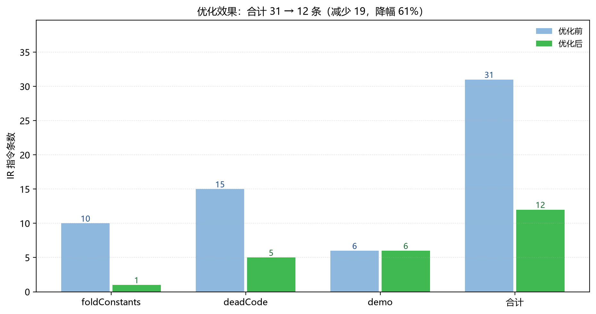
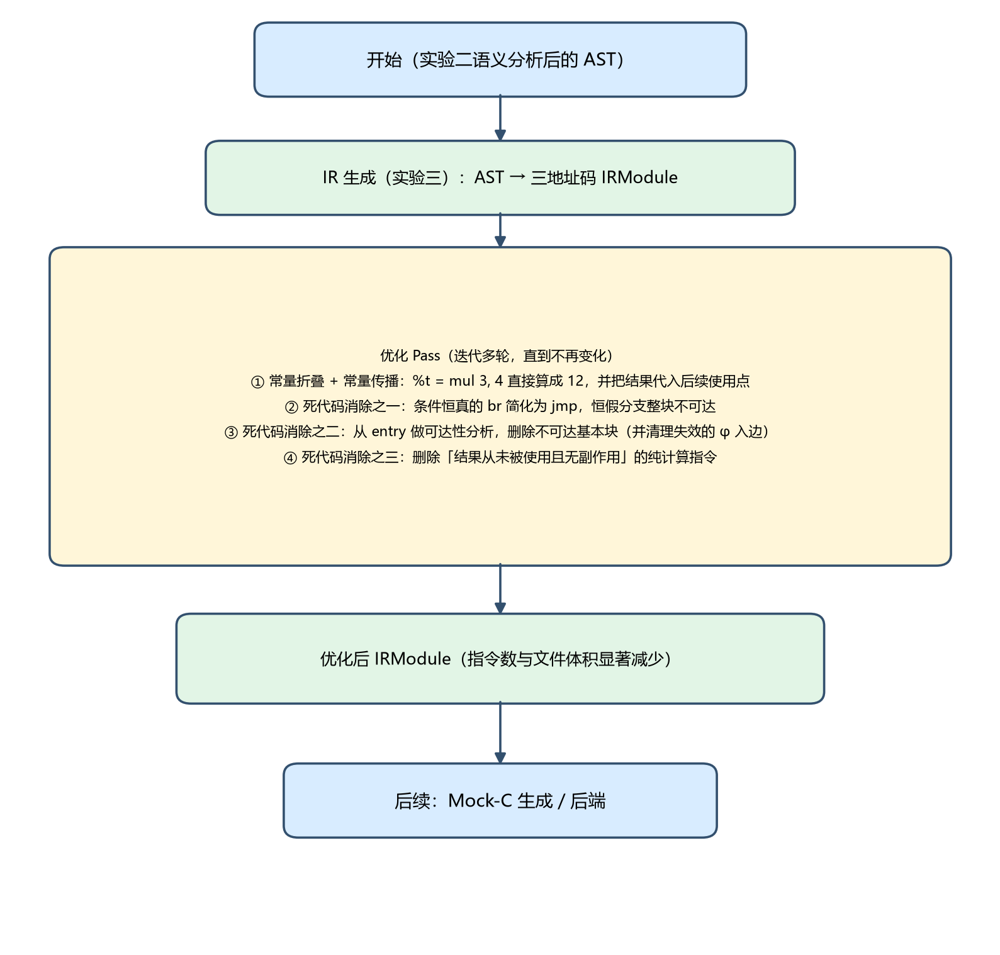
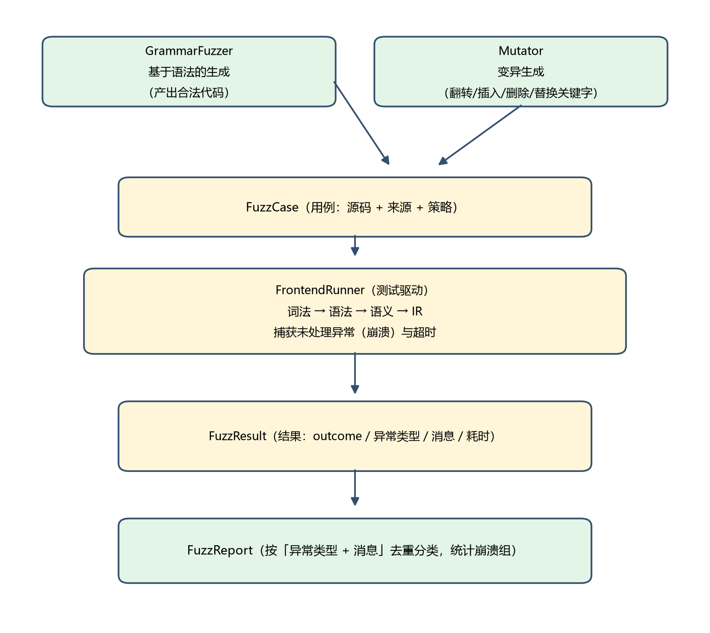
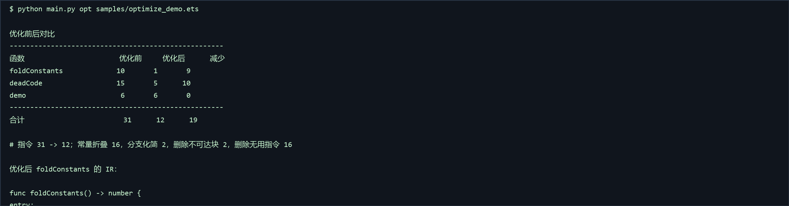
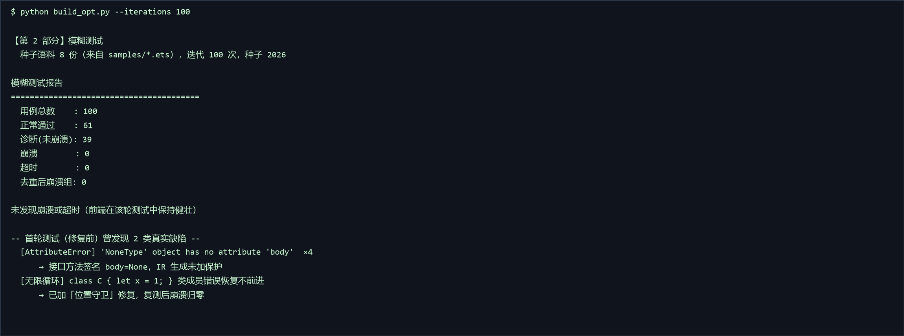

# 实验四  AOT 优化与自动化测试（Fuzzing）

## 1 内容简介

AOT（Ahead-of-Time）编译指在程序运行之前就把源代码编译为目标代码，与之相对的 JIT 则在程序运行期间边解释边编译。对鸿蒙这类移动场景而言，AOT 的优势很明显：① 用户拿到应用后启动即可执行，**没有 JIT 预热与编译抖动**，启动更快、体验更稳定；② 省去了运行期编译器与解释器，**内存占用与电池开销更低**；③ 编译期掌握全部代码，可以放心做**跨函数的深度优化**（内联、常量传播、死代码消除等），而 JIT 受限于编译时间只能做局部优化。代价是编译发生在开发/安装阶段、无法针对运行期的实际类型做投机优化。

本实验在实验三生成的 IR 之上实现了两种经典 AOT 优化，并实现了一个针对编译器前端的模糊测试器。

- 常量折叠（Constant Folding）：在编译期把「操作数全是常量」的表达式直接算出结果，如 %t = mul 3, 4 直接变成 12，省去运行期的一条乘法；
- 常量传播（Constant Propagation）：把已折叠出的常量代入后续指令的操作数，使原本依赖变量的表达式也变成常量，从而引发连环折叠；
- 死代码消除（Dead Code Elimination）：移除永远不会执行的代码——条件恒真/恒假的分支、不可达基本块，以及「结果从未被使用且无副作用」的纯计算指令。

模糊测试部分实现了一个 GrammarFuzzer（基于语法生成合法代码）、一个 Mutator（对种子做位翻转/插入/删除/关键字替换等变异）、一个 FrontendRunner（把用例喂给「词法 → 语法 → 语义 → IR」整条前端并捕获崩溃与超时），以及一个按异常指纹去重分类的 FuzzReport。

实测：优化使样例的 IR 指令数从 31 条降到 12 条（降幅 61%）；模糊测试首轮就发现了 2 个真实缺陷（一个空指针崩溃、一个无限循环），修复后复测 100 个用例崩溃数归零。配套单元测试 128 个全部通过。

## 2 实验上机试题

（1）AOT 优化实现：选择 1-2 种经典 IR 级优化技术进行实现（常量折叠、死代码消除）；对优化前后的 IR 进行对比分析，验证优化的有效性。

（2）模糊测试设计与实现：设计一个模糊测试器，用于测试整个编译器前端（词法分析 → 语法分析 → 语义分析 → IR 生成）的健壮性；实现基于语法的生成与变异生成两种策略；实现测试驱动，自动输入并监控运行状态；记录崩溃、断言失败或超时，并进行去重和初步分类。

## 3 算法实现

### 3.1 常量折叠与常量传播

实现思路是「一趟扫描 + 常量表」：遍历每个基本块的指令，先用已知常量表替换操作数（传播），再判断该指令的操作数是否全为常量——若是，则在编译期调用求值函数算出结果，把这条指令替换成「常量赋值」，并把目标变量记入常量表，供后续指令继续使用。这样一次扫描就能形成连锁折叠：2 + 3 * 4 会先折叠 3 * 4 = 12，再折叠 2 + 12 = 14。

求值支持数值的加减乘除取模、比较、逻辑与位运算，以及字符串拼接；对除零、溢出等异常情况返回 None（表示「不敢折」），保证优化不会改变程序语义。

```
def _fold_constants(self, func) -> int:
    """常量折叠 + 常量传播：把已知常量代入后续指令的操作数。"""
    constants: dict[str, str] = {}
    folded = 0
    for block in func.blocks:
        for index, ins in enumerate(block.instructions):
            ins.args = _substitute(ins.args, constants)      # ① 常量传播
            value = _try_fold(ins)                           # ② 尝试求值
            if value is None:
                continue
            constants[ins.dst] = value                       # ③ 记入常量表
            block.instructions[index] = ir.IRInstruction(    # ④ 替换为常量赋值
                op=ir.OP_ASSIGN, dst=ins.dst, args=[value], device=ins.device,
            )
            folded += 1
    return folded

def _try_fold(ins):
    """若指令的所有操作数都是常量，就在编译期把结果算出来。"""
    if ins.op in ir.BINARY_OPS and len(ins.args) >= 2:
        left, right = ins.args[0], ins.args[1]
        if _is_const(left) and _is_const(right):
            return _eval_binary(ins.op, left, right)   # add/sub/mul/... 直接算
    if ins.op in (ir.OP_NEG, ir.OP_NOT, ir.OP_BNOT) and ins.args and _is_const(ins.args[0]):
        return _eval_unary(ins.op, ins.args[0])
    return None
```

代码中 _substitute 还需要正确处理 φ 指令的操作数——φ 的操作数是 (值, 前驱标签) 二元组，替换时要保留标签、只替换值。

### 3.2 死代码消除

死代码消除分三层，逐层收紧：

- 分支化简：条件已是常量（如 if (false)）的 br 指令直接替换为 jmp，指向必定执行的那一侧；
- 不可达块删除：从 entry 出发沿 br/jmp 做可达性分析，凡是走不到的块整体删除；删除后还要清理 φ 中指向已删块失效的入边，若只剩一个入边则把 φ 退化为普通赋值；
- 无用指令删除：收集所有被引用过的操作数，凡是「有目标变量、该变量从未被使用、且指令无副作用」的纯计算指令一律删除。函数调用、字段/数组写入、对象构造都不算纯，必须保留。

```
def _simplify_branches(self, func) -> int:
    """条件恒为常量的 br 直接简化为 jmp（例如 if (false) / if (true)）。"""
    count = 0
    for block in func.blocks:
        for index, ins in enumerate(block.instructions):
            if ins.op != ir.OP_BR:
                continue
            cond = _const_bool(ins.args[0])
            if cond is None:
                continue
            target = ins.args[1] if cond else ins.args[2]
            block.instructions[index] = ir.IRInstruction(op=ir.OP_JMP, args=[target])
            count += 1
    return count

def _remove_unreachable(self, func) -> int:
    """从 entry 出发做可达性分析，删除不可达基本块。

    注意：φ 的「前驱」只是它记录的控制流来源，可达性必须由 br / jmp 决定，
    因此不把 φ 的前驱算作可达；删除块之后再清理 φ 中失效的入边。
    """
    reachable, stack = set(), [func.blocks[0].label]
    while stack:
        label = stack.pop()
        if label in reachable or label not in labels:
            continue
        reachable.add(label)
        for ins in by_label[label].instructions:
            if ins.op == ir.OP_JMP:
                stack.append(ins.args[0])
            elif ins.op == ir.OP_BR:
                stack.append(ins.args[1]); stack.append(ins.args[2])
    if len(func.blocks) != len(reachable):
        func.blocks = [b for b in func.blocks if b.label in reachable]
        self._prune_phi(func, reachable)      # 只剩一个入边时 φ 退化为赋值
    return len(func.blocks) - len(reachable)

def _remove_unused(self, func) -> int:
    """删除结果从未被使用、且无副作用的纯计算指令（函数调用不算）。"""
    used = set(...)                            # 收集所有被引用的操作数
    for block in func.blocks:
        block.instructions = [
            ins for ins in block.instructions
            if not (ins.dst and ins.dst not in used and ins.op in _PURE_OPS)
        ]
    return removed
```

这里踩过一个坑：最初的可达性分析把 φ 的前驱也当成「可达」，结果恒假分支的块因为仍被 φ 引用而删不掉（block_removed 一直是 0）。正确的做法是——**可达性只由控制流（br/jmp）决定**，φ 只是记录「值来自哪条边」，删块之后再清理它的入边。修正后 block_removed 变成 2。

### 3.3 优化效果的量化分析

优化在 IR 生成之后运行，可迭代多轮（每轮折叠可能暴露出新的死代码），直到不再发生变化。以 samples/optimize_demo.ets 为例，优化效果如下：

```
$ python main.py opt samples/optimize_demo.ets
优化前后对比
----------------------------------------------------
函数                       优化前     优化后      减少
foldConstants             10       1       9
deadCode                  15       5      10
demo                       6       6       0
----------------------------------------------------
合计                        31      12      19

# 指令 31 -> 12；常量折叠 16，分支化简 2，删除不可达块 2，删除无用指令 16
  前端: 无错误
```

逐函数来看：foldConstants 从 10 条降到 1 条（整个函数体被折叠成一条 ret 14）；deadCode 从 15 条降到 5 条（恒假分支整块删除、无用赋值删除）；demo 保持 6 条（它本身就是三个函数调用，没有可折叠的常量）。合计 **31 → 12 条，降幅 61%**，其中常量折叠 16 条、分支化简 2 处、删除不可达块 2 个、删除无用指令 16 条。

值得注意的是：优化是**链式**的——常量折叠让 if 的条件变成常量，进而触发分支化简，分支化简让整块不可达，进而触发块删除与无用指令删除，删除后又有新的常量可以传播……这正是需要多轮迭代的原因。



*图4.2  优化前后各函数 IR 指令数对比*



*图4.1  AOT 优化在编译流程中的位置与内部四步*

### 3.4 模糊测试器的设计思路与关键模块

模糊测试的核心思想是「用大量随机输入去撞击程序，观察它是否崩溃」。对编译器前端来说，最有价值的崩溃是**未处理的异常**（说明某个边界没有考虑到）与**超时/死循环**（说明错误恢复没有终止）。整体架构分四个模块：

- GrammarFuzzer（用例生成-语法）：按 ArkTS 子集文法随机拼装函数、变量、算术表达式、比较条件、if/while/for 语句，只产出**合法**代码，用于验证「正常路径」不会出错；
- Mutator（用例生成-变异）：对种子语料做 7 种变异——字符翻转、插入、删除、截断、复制行、交换字符、关键字替换，用于撞击**非法输入的边界路径**；
- FrontendRunner（测试驱动）：把用例依次喂给 tokenize → parse → analyze → irgen，捕获一切异常并记录耗时；按 outcome 分为 ok / diagnostics / crash / timeout 四类；
- FuzzReport（结果收集）：按「异常类型 + 消息前 80 字符」作为指纹去重，把同一类问题的多个复现归并成一组，并统计各类数量。

整个随机过程都由种子驱动，因此**任何一次崩溃都能用同一种子精确复现**；模块还带总时间预算（max_seconds）与「卡死现场记录」（把当前用例实时写入文件），保证即使出现死循环也能定位到具体输入。

```
class FrontendRunner:
    """把用例输入整条编译器前端，捕获崩溃与超时。"""

    def run(self, case: FuzzCase, timeout_ms: float = 3000.0) -> FuzzResult:
        start = time.perf_counter()
        try:
            tokens, lex_errors = tokenize(case.source)
            program, parse_errors = parse(tokens)
            sema_errors, analyzer = analyze(program)
            irgen.generate(program, analyzer)
            diagnostics = len(lex_errors) + len(parse_errors) + len(sema_errors)
            outcome = "diagnostics" if diagnostics else "ok"
            ...
        except Exception as exc:      # 模糊测试就是要捕获一切异常
            return FuzzResult(case, "crash", error_type=type(exc).__name__,
                              message=str(exc), detail=traceback.format_exc())
```

编排器 Fuzzer 以约 50% 的概率在「语法生成」与「变异生成」之间切换：

```
class Fuzzer:
    def run(self, iterations=200, max_seconds=None) -> FuzzReport:
        report, case_id = FuzzReport(), 0
        started = time.perf_counter()
        for _ in range(iterations):
            if max_seconds and (time.perf_counter() - started) > max_seconds:
                break                        # 总时间预算，到点即停
            case_id += 1
            if self.seed_corpus and self.grammar.rnd.random() < 0.5:
                source = self.mutator.mutate(self.grammar.rnd.choice(self.seed_corpus))
                case = FuzzCase(case_id, source, "mutate")   # 变异生成
            else:
                case = FuzzCase(case_id, self.grammar.generate(), "grammar")
            report.cases.append(case)
            report.results.append(self.runner.run(case))
        return report

# 去重指纹：按「异常类型 + 消息前 80 字符」把同类问题归并成一组
@property
def fingerprint(self) -> tuple:
    if self.outcome == "crash":
        return (self.error_type, self.message[:80])
    return (self.outcome, "")
```



*图4.3  模糊测试器的四个模块与数据流*

### 3.5 实现结果：IR 对比与模糊测试结果



*图4.4  优化前后对比与优化后的 IR（真实输出）*

图 4.4 是优化命令的真实输出：可以看到 foldConstants 优化后只剩一条 ret 14——常量被完整折叠并传播到了返回处，中间的所有运算与赋值都成为死代码被清除。



*图4.5  模糊测试运行结果与首轮发现的缺陷*

模糊测试运行结果（修复后复测）：

```
$ python build_opt.py --iterations 100
  种子语料 8 份（来自 samples/*.ets），迭代 100 次，种子 2026

模糊测试报告
========================================================
  用例总数    : 100
  正常通过    : 61
  诊断(未崩溃): 39
  崩溃        : 0
  超时        : 0
  去重后崩溃组: 0

未发现崩溃或超时（前端在该轮测试中保持健壮）
```

## 4 测试

针对优化 Pass 与模糊测试器分别设计测试用例，覆盖正常值、边界值与错误值。

**表4.1  优化 Pass 测试用例**

| 用例编号 | 测试项 | 测试步骤 | 预期结果 | 测试结果 |
| --- | --- | --- | --- | --- |
| 1 | 常量折叠：算术 | let a: number = 2 + 3 * 4; | 乘法先折叠为 12、加法折叠为 14；优化后 IR 中不再出现 mul | 通过 |
| 2 | 常量传播：跨语句 | let a = 2 + 3; let b = a * 2; | a 传播为 5、b 折叠为 10，一路传播到 ret 10 | 通过 |
| 3 | 常量折叠：字符串拼接 | let s: string = "a" + "b"; | 折叠为字面量 "ab" | 通过 |
| 4 | 死代码：恒假分支 | let x = 1; if (false) { x = 99; } return x; | br 简化为 jmp，then 块不可达被删除，IR 中不再有 if.then | 通过 |
| 5 | 死代码：恒真分支 | if (true) { x = 2; } else { x = 3; } return x; | else 分支被删除，结果只保留 2（优化后 ret 2） | 通过 |
| 6 | 死代码：无用赋值 | let unused: number = x * 100;（结果未被使用） | 该赋值指令被删除，IR 中不再出现 unused | 通过 |
| 7 | 边界值：带副作用调用不可删 | let x = g();（g 是函数调用） | 函数调用可能带副作用，不能被当作死代码删除 | 通过 |
| 8 | 优化后仍可生成 C | 对优化后的模块调用 generate_c | 生成的 Mock-C 仍包含 ark_demo，未产生非法代码 | 通过 |

**表4.2  模糊测试器测试用例**

| 用例编号 | 测试项 | 测试步骤 | 预期结果 | 测试结果 |
| --- | --- | --- | --- | --- |
| 1 | 语法生成器产出合法代码 | 用 10 个不同种子各生成一份代码并跑完整前端 | 词法/语法/语义诊断均为 0（生成器只产出合法代码） | 通过 |
| 2 | 语法生成可复现 | 同一种子生成两次 | 两份代码完全相同 | 通过 |
| 3 | 变异生成改动源码 | 对同一份种子连续变异 30 次 | 绝大多数结果与原串不同（>20 次） | 通过 |
| 4 | 变异生成可复现 | 同一种子变异同一份源码 | 结果完全相同 | 通过 |
| 5 | 驱动分类：正常 | 输入合法代码 | outcome = ok | 通过 |
| 6 | 驱动分类：有诊断 | 输入 let x: number = 'a'; | outcome = diagnostics（不崩溃） | 通过 |
| 7 | 去重统计 | 构造 3 个同指纹 + 1 个异指纹的 crash 结果 | 崩溃 4、去重后崩溃组 2 | 通过 |
| 8 | 边界值：空输入变异 | Mutator 对空字符串变异 | 原样返回空串，不抛异常 | 通过 |
| 9 | 批量运行 | Fuzzer(seed=7).run(40) | 恰好产生 40 个用例，且同种子结果可复现 | 通过 |

以上用例均已实现为自动化单元测试（tests/test_optimizer.py、tests/test_fuzzer.py），执行 python -m unittest discover -s tests 可一次性运行全部 128 个用例（含实验一~三的 105 个），实测全部通过。

## 5 典型异常案例分析

本轮模糊测试最有价值的产出，是**发现了两个靠人工测试很难想到的真实缺陷**。这也是模糊测试之于编译器开发的意义所在。

#### 案例 1：接口方法导致 IR 生成崩溃（AttributeError）

现象：首轮 100 个用例中，有 4 次以 `AttributeError: 'NoneType' object has no attribute 'body'` 崩溃，指纹完全一致（去重后为 1 组）。

定位过程：模糊测试器记录了复现用例——它是从 samples/sema_ok.ets 变异而来的。逐个阶段排查后确认崩溃发生在 **IR 生成**阶段。

根因：ArkTS 的接口里方法**只有签名、没有方法体**（`greet(name: string): string;` 后面是分号而非花括号），因此 AST 里这些方法的 `body` 是 `None`。语义分析器对这种情况做了保护（`if method.body is None: return`），但 **IR 生成器忘了保护**，直接访问 `node.body.body` 就炸了。人工写的样例（sema_ok.ets）虽然包含接口，但它是「合法且完整」的文件，而变异后的版本恰好把路径引到了这块未保护的分支。

修复：① 接口不参与计算型 IR 生成，`_gen_class` 里遇到 `interface` 直接返回；② `_gen_function` 里对 `body is None` 加保护。修复后复测，该指纹的崩溃数归零。

#### 案例 2：类成员错误恢复不前进导致无限循环

现象：修复案例 1 之后再次运行，`build_opt.py` **卡在第 2 部分不再返回**，即模糊测试器的某次迭代永远出不来。

复现输入：`class C { let x = 1; }` —— 在**类体里**写了一条 `let` 语句。

根因：语法分析器的错误恢复策略是「恐慌模式 + 同步集」：出错后由 `_synchronize()` 跳到下一个安全点。为了不吞掉下一条合法语句，`_synchronize()` 在遇到「语句起始符」（如 let/if/while）时会**立即返回且不消费 token**——这在语句层是对的，但在**类成员层**就出问题了：类成员循环发现当前位置的 `let` 无法解析成成员，交给 `_synchronize()`，而后者看到 `let` 是语句起始符就原地返回；类成员循环于是**反复重试同一个位置**，形成无限循环。

修复：给 `_statement` 与 `_class_member` 都加「位置守卫」——记录进入时的 token 下标，恢复之后若下标没有变化，就强制 `_advance()` 消费一个 token。这样无论错误恢复策略怎么选择，**每轮至少前进一个 token**，从根上杜绝死循环。

```
def _statement(self):
    start = self.pos                      # 记录进入位置
    try:
        return self._statement_inner()
    except ParseError as exc:
        self.errors.append(exc.diagnostic)
        self._synchronize()
        if self.pos == start:             # 保底：任何情况下都必须前进
            self._advance()
        return None
```

这两个案例共同说明：模糊测试擅长的**不是**验证「功能对不对」，而是发现「开发者根本没意识到的输入路径」。`class C { let x = 1; }` 这种写法人工几乎不会去测，但随机变异的字符序列轻而易举地命中了它。

## 6 模糊测试的重要性与覆盖率提升

模糊测试在编译器开发中的地位：编译器是「接受任意输入的程序」，其正确性边界极难靠人工用例穷举——尤其是语法分析、错误恢复、类型检查这些充满分支的阶段。工业界的编译器（Clang、GCC、V8、Rustc）都把 fuzzing 作为常规 CI 环节，因为**一个崩溃就意味着真实用户的代码可能让编译器挂掉**；对前端而言，崩溃还意味着 IDE 卡死。本实验的两个缺陷正是最好的例证。

如何提升模糊测试的效率与覆盖率：

- 覆盖率引导（Coverage-guided Fuzzing）：这是现代 fuzzer 的核心机制——运行时插桩记录每份输入覆盖了哪些代码分支，当某份输入触发了**新的覆盖**时把它加入语料库；下一轮基于该语料继续变异。这样随机搜索就变成了「朝着未探索区域前进」的有向搜索。著名的 AFL、libFuzzer、Honggfuzz 都是这个思路；
- 语法感知/结构化变异：对编译器这类输入语言有严格语法的目标，纯字节变异大多会立即被词法拒绝，效率很低。改为在 AST/语法树层面变异，或使用语法模板生成，能保证输入**能走得更深**（本实验的 GrammarFuzzer 就是这个思路的简化版）；
- 差分测试（Differential Testing）：同一份输入同时喂给两个实现（如本编译器与官方编译器），比较结果是否一致，可以发现问题**而非崩溃**的逻辑错误；
- 断言与不变量：在编译器内部插入大量断言（如「AST 节点类型必须匹配」「作用域栈必须平衡」），把「默默产生错误结果」变成「立刻崩溃」，从而让 fuzzing 更容易发现问题；
- 种子语料与去重：用真实程序做种子（本实验用 samples/*.ets），并按指纹去重，避免同一个 bug 反复刷屏、掩盖其它问题；
- 超时与内存限制：死循环与内存爆炸同样是需要发现的缺陷，必须设置时间与内存上限（本实验加了 max_seconds 与「卡死现场记录」）。

## 7 难点和解决办法

#### 难点 1：常量折叠必须「不敢折」而不是「乱折」

问题：除零、溢出、字符串与非字符串混算等情况，若强行求值会改变程序语义（甚至让编译器自身抛异常）。

解决办法：求值函数在所有异常分支统一返回 None，表示「无法在编译期确定」，此时保留原指令不动。宁可少优化，也不能改变语义。

#### 难点 2：可达性分析中 φ 指令的处理

问题：φ 的入边记录了「值来自哪条边」，最初把 φ 的前驱也算作可达，导致恒假分支删不掉（block_removed 恒为 0）。

解决办法：可达性只由控制流（br/jmp）决定；删块之后再清理 φ 中失效的入边，只剩一条入边时把 φ 退化为普通赋值（这正是 out-of-SSA 的思想）。

#### 难点 3：死代码判定必须区分「纯计算」与「有副作用」

问题：函数调用、字段写入、数组写入虽然可能「结果没人用」，但它们的副作用是程序语义的一部分，一旦删除就会改变行为。

解决办法：维护一份「纯操作码」白名单（算术/比较/逻辑/赋值/纯读取），只有白名单内的指令且目标变量未被使用时才允许删除。

#### 难点 4：模糊测试可能「卡住」，而卡住时你看不到任何输出

问题：模糊测试发现死循环时，进程会一直挂住，既没有报告也看不出是哪个输入导致的。

解决办法：三重保障——① 脚本自带总时间预算（max_seconds）；② 每轮迭代前把「当前用例」实时写入 out/fuzz_current.txt（卡死现场记录），事后直接从文件里拿到复现输入；③ 修复层面从根上消除死循环（位置守卫）。

## 8 思考题

#### 思考题 1：AOT 编译与 JIT 编译各有何优缺点？鸿蒙系统为何选择 AOT 作为重要的编译方式？

AOT（提前编译）的优点：① 启动即可执行，没有 JIT 的预热与编译停顿，启动速度快、帧率稳定（对移动端的首屏体验尤其重要）；② 不需要在设备上驻留编译器与解释器，内存占用和耗电更低；③ 编译期能看到全部代码，可做跨函数、跨模块的深度优化（内联、常量传播、死代码消除、甚至针对具体机型做指令调度）。缺点：① 无法利用运行期的实际类型等信息做投机优化（如虚调用的去虚化）；② 编译产物与目标平台绑定，跨平台需要分别编译；③ 开发调试周期中每次改动都要重新编译。

JIT（即时编译）的优点：能依据运行期热点与真实类型做激进优化，理论上峰值性能更高，且支持动态语言特性（如动态派发、类型多态）。缺点：有预热开销与编译抖动、常驻编译器占用内存与电量、实现复杂。

鸿蒙选择 AOT 作为重要编译方式，根源在于**移动端的场景约束**：用户对启动速度、流畅度与续航非常敏感；应用分发后无需支持任意动态代码加载（ArkTS 又通过「去动态化」限制了动态特性）；再加上应用安装/更新本身就是天然的编译时机。因此把编译尽量前移到开发与安装阶段，用编译期的确定性换取运行期的稳定与低开销，是符合移动端利益的选择。实践中鸿蒙采用 AOT 与「解释/JIT 兜底」结合的混合策略，以兼顾冷启动与动态场景。

#### 思考题 2：除了常量折叠和死代码消除，还有哪些重要的 IR 级优化技术？

- 公共子表达式消除（CSE）/ 值编号：同一表达式被多次计算时只算一次——在 SSA 形式下用值编号（GVN）即可识别 a+b 与 b+a 等价；
- 循环不变量外提（LICM）：把循环体内不随迭代变化的计算移到循环外；
- 强度削弱：把昂贵的运算换成廉价的，如 i*4 换成自增指针、乘除换移位；
- 函数内联：把被调用函数体展开到调用点，消除调用开销并为后续优化创造条件；
- 内联后常量传播 + 死代码消除：三者常配合使用，是「优化流水线」的经典组合；
- 尾调用消除：把尾递归改写为循环，节省栈空间；
- 寄存器分配与指令调度：更偏后端，但同样在 IR（或机器 IR）上进行；含循环展开（unrolling）、软件流水（software pipelining）、SIMD 向量化；
- 去虚化（devirtualization）：把运行期的动态派发在编译期确定为具体实现，是面向对象语言 AOT 的关键优化。

#### 思考题 3：如何提高模糊测试的覆盖率？覆盖率引导的模糊测试（Coverage-guided Fuzzing）是如何工作的？

提升覆盖率的常用手段：种子语料要真实且多样（用真实程序而非纯随机串）；采用语法感知的结构化生成/变异，避免「一改就被词法拒绝」；保留能触发新路径的输入持续演化；对难以到达的分支使用定向（directed）策略；以及在被测程序中插入断言，把「静默错误」变成「可观测崩溃」。

覆盖率引导模糊测试的工作机制：① 编译时对目标程序做**插桩**，在每个分支/基本块记录「是否被走到」，形成覆盖位图（bitmap）；② 每执行一份输入，收集其覆盖位图；③ 若该输入触发了一个**此前从未被覆盖**的边，就认为它「有探索价值」，把它加入语料库（corpus），否则丢弃；④ 下一轮从语料库里挑输入继续变异。这样搜索方向就从「盲目随机」变成了「始终朝着未探索区域前进」，覆盖率增长更快，也更容易挖到深层 bug（AFL 的 fork server、libFuzzer 的 SanitizerCoverage 都是这个思路）。本实验的 GrammarFuzzer/Mutator 是这个机制的简化版——尚未实现真正的覆盖反馈，这也是可以继续改进的地方。

#### 思考题 4：针对编译器前端和后端的模糊测试，在测试策略和用例生成上有何不同？

前端（词法/语法/语义）的模糊测试：输入是**源代码文本**，目标是发现崩溃（未处理异常）、死循环、错误恢复失效。用例生成侧重「语法合法性」与「边界构造」——因为纯字节变异大多会被词法层直接拒绝，效率极低；因此更常用语法生成（grammar-based）、AST 变异（在语法树层面增删节点）、以及针对错误恢复的「残缺输入」（如删掉一个右括号）。判据多为「是否崩溃/是否终止」。

后端（IR → 机器码）的模糊测试：输入是**IR 序列或 IR 文本**（如 LLVM IR），目标是发现**错误编译**（miscompilation）——生成的机器码与 IR 语义不一致，这类问题通常不会崩溃，只会算错。因此必须用**差分测试**：把同一份 IR 分别用「被测后端 -O0」与「-O2」编译，或与解释执行（lli）的结果比对，不一致即判定为 bug。用例生成侧重「IR 结构多样性」（各种控制流形状、循环嵌套、以及大量边界常量如 INT_MIN/-1 触发溢出），并常配合 Alive2 这类「翻译验证器」做形式化校验。

归纳为一句话：**前端 fuzzing 关心「程序会不会崩」，后端 fuzzing 关心「结果对不对」**——目标不同，导致两者的用例生成策略、判定准则（oracle）与去重标准都不同。本实验做的是前端 fuzzing，因此以「捕获异常 + 超时检测」作为判定准则。
